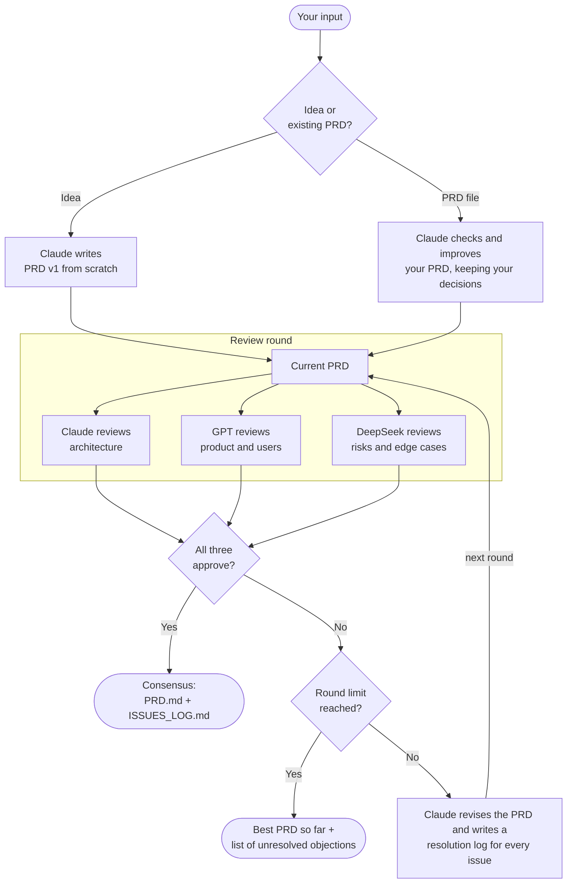
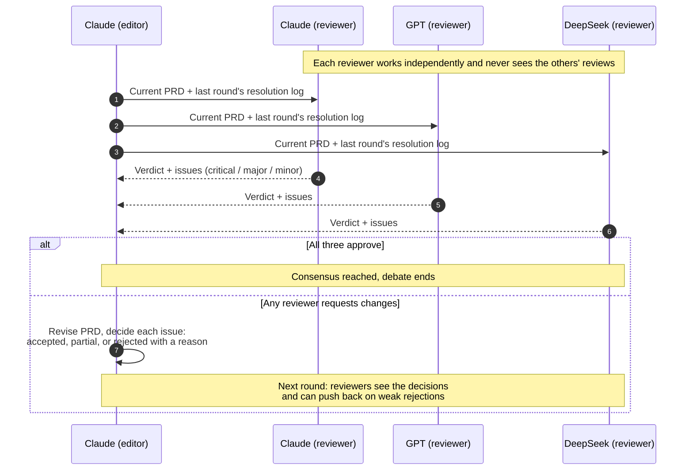

# PRD Council

**Three AI models debate your product idea until they all agree on one PRD.**

Claude, GPT and DeepSeek each have different strengths and different blind spots. A PRD written by one model will miss things another model would catch. PRD Council makes them review each other's work, argue about it, and keep revising until all three sign off on the same final Product Requirements Document (PRD).

You get two things at the end:

1. **`PRD.md`**: a final PRD that all three models approved, ready to hand to Claude Code (or any coding agent) to build.
2. **`ISSUES_LOG.md`**: every issue each model raised, and how it was resolved. This shows you exactly what each model caught that the others missed.

---

## Why three models?

| Model | Role on the council | What it focuses on |
|---|---|---|
| **Claude** | Editor and architect | Writes and revises the PRD. As a reviewer: is the architecture sound, are requirements consistent and specific enough for a coding agent to build without guessing? |
| **GPT** | Product critic | Is the problem clear, are the users and user flows complete, is the MVP scope right, are success metrics measurable? |
| **DeepSeek** | Risk reviewer | What can go wrong: edge cases, error handling, security and privacy gaps, scaling limits, cost surprises, unrealistic milestones. |

Giving each reviewer a different focus produces sharper, less overlapping feedback than three generic reviews.

---

## How the debate works

### The overall flow



### What happens inside one round



### The rules that make it a real debate

1. **Independent reviews.** Every review is a fresh session. A reviewer never sees what the other two said, so they can't just copy each other.
2. **Severity ratings.** Each issue is marked critical, major or minor.
3. **No easy approvals.** A reviewer cannot vote "approve" while it still has a critical or major issue. The script enforces this even if the model tries.
4. **Accountable editor.** The editor must answer every issue: accepted, partially accepted, or rejected with a reason. It cannot silently ignore feedback.
5. **Pushback.** In the next round, reviewers see the editor's decisions. If a rejection's reason is weak, they raise the issue again. If it's sound, they drop it.
6. **Anti groupthink.** Reviewers are told not to approve just to be agreeable, and not to invent problems to look thorough.
7. **Bounded.** The debate stops at consensus or at the round limit (default 3). If there's no consensus, the remaining objections are listed for you to decide.

---

## Cost: nearly free

| Model | How it runs | Cost |
|---|---|---|
| Claude | Claude Code CLI | Covered by a Claude Pro subscription |
| GPT | Codex CLI | Covered by a ChatGPT Plus subscription |
| DeepSeek | OpenRouter API (or DeepSeek's own API) | Free model when available, otherwise under 1 cent per full run |

The models never see your codebase. Every call runs in an empty temporary folder and only sees your idea and the PRD text.

---

## Setup (one time)

You need **Python 3.8+** and **Node.js**. No Python packages are required.

### 1. Claude Code (uses your Claude Pro plan)

```bash
npm install -g @anthropic-ai/claude-code
claude
```
Log in with your Claude account when asked, then type `/exit`.

### 2. Codex CLI (uses your ChatGPT Plus plan)

```bash
npm install -g @openai/codex
codex
```
Choose **Sign in with ChatGPT**, log in, then exit.

### 3. OpenRouter key (for DeepSeek)

OpenRouter's free DeepSeek models come and go. When none is free, the script automatically uses the cheapest paid DeepSeek model, so add a small credit balance:

1. Sign up at https://openrouter.ai
2. Add $5 of credit at https://openrouter.ai/settings/credits (lasts hundreds of runs)
3. Create a key at https://openrouter.ai/settings/keys (it starts with `sk-or-`)
4. Set it in the terminal you will run the script from:

```bash
# Mac / Linux
export OPENROUTER_API_KEY="sk-or-..."

# Windows PowerShell
$env:OPENROUTER_API_KEY="sk-or-..."
```

To make it permanent on Windows, use `setx OPENROUTER_API_KEY "sk-or-..."` and then **open a new terminal**.

Prefer DeepSeek directly? Create a key at https://platform.deepseek.com, top up a couple of dollars, and set `DEEPSEEK_API_KEY` instead.

### 4. Check that all three models respond

```bash
python prd_council.py --check
```

You should see `OK` for Claude, GPT and DeepSeek.

---

## Usage

### Start from an idea

Write your idea in a text file (more detail gives a better PRD):

```bash
python prd_council.py idea.txt
```

Or pass a short idea directly:

```bash
python prd_council.py "A habit tracker app for college students with streaks and reminders"
```

### Start from your own PRD

```bash
python prd_council.py --prd my_prd.md
```

Claude first checks and improves your PRD: it keeps your decisions, structure and wording wherever they are sound, fixes contradictions and vague requirements, fills missing sections, and adds a **Changes From Original** section. Then the full council debates it. Reviewers are told your product decisions are authoritative, so they critique gaps instead of overriding your choices.

### Try it without using any quota

```bash
python prd_council.py idea.txt --mock
```

Runs the whole flow with fake responses so you can see how it works.

### Options

| Option | What it does |
|---|---|
| `--prd FILE` | Start from your existing PRD instead of an idea |
| `--rounds N` | Maximum review rounds (default 3) |
| `--editor gpt` | Let GPT (or `deepseek`) write and revise instead of Claude |
| `--out FOLDER` | Where to save results (default `prd_runs`) |
| `--check` | Test that all three models respond, then exit |
| `--mock` | Dry run with fake responses, uses no quota |

A typical run takes 5 to 15 minutes.

---

## Output

Each run creates a timestamped folder, `prd_runs/<date_time>/`:

| File | Contents |
|---|---|
| `PRD.md` | The final agreed PRD |
| `ISSUES_LOG.md` | Every issue per round, per model, and the editor's decision on each |
| `rounds/` | Every PRD version and every raw review, so you can trace the whole debate |
| `idea.txt` or `original_prd.md` | A copy of your input |

### The PRD structure

Every PRD covers these sections:

1. Overview and Problem Statement
2. Goals and Non Goals
3. Target Users and Personas
4. User Stories and Key User Flows
5. Functional Requirements (numbered and testable)
6. Non Functional Requirements
7. Scope: MVP vs Later Phases
8. Technical Approach (architecture, stack, data model, integrations)
9. Edge Cases and Error Handling
10. Risks and Mitigations
11. Success Metrics
12. Milestones
13. Open Questions

### After the debate

Hand `PRD.md` to Claude Code to start building:

```bash
claude "Read PRD.md and create an implementation plan, then build the MVP."
```

---

## Optional settings

| Environment variable | Purpose |
|---|---|
| `CLAUDE_MODEL` | Choose a Claude model, for example `opus` or `sonnet` |
| `CODEX_MODEL` | Choose the GPT model Codex uses |
| `DEEPSEEK_MODEL` | Force a specific OpenRouter model ID |
| `DEEPSEEK_API_KEY` | Use DeepSeek's own API instead of OpenRouter |
| `COUNCIL_TIMEOUT` | Seconds to wait per Claude or GPT call (default 900) |

---

## Troubleshooting

| Problem | Fix |
|---|---|
| `'claude'` or `'codex'` not found on PATH | Install it (setup step 1 or 2) and open a new terminal |
| DeepSeek error **401** | Key is wrong or not set in this terminal. Check with `echo $OPENROUTER_API_KEY` (or `echo $env:OPENROUTER_API_KEY` in PowerShell) |
| DeepSeek error **402** | No OpenRouter credits. Add a few dollars at https://openrouter.ai/settings/credits |
| DeepSeek error **404** mentioning "data policy" | Open https://openrouter.ai/settings/privacy and allow the setting it asks for |
| DeepSeek rate limited | The script retries automatically. If it keeps failing, wait or use `DEEPSEEK_API_KEY` |
| Hitting Claude Pro or ChatGPT Plus limits | Each round makes several calls. Use `--rounds 2` for smaller ideas |
| A reviewer is unavailable in a round | The round continues with the others, but consensus requires all three |

---

## Project structure

```
prd_council.py   the whole system: prompts, model callers, debate loop, output writer
README.md        this file
.gitignore       keeps prd_runs/ (your private ideas and PRDs) out of git
```
